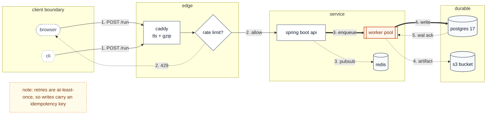
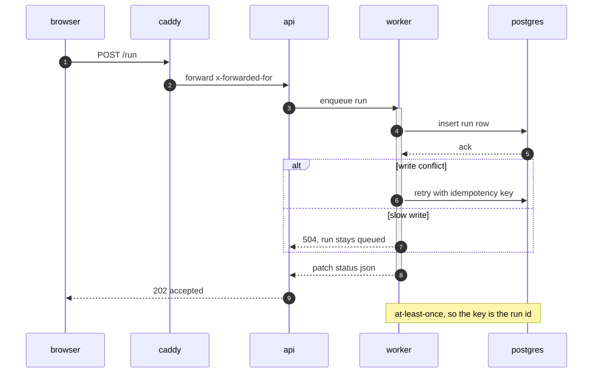

# Diagram vocabulary (architect style)

Every diagram in a post is a claim, not decoration. It must show the shape of a
system with the smallest set of elements that makes the claim visible. Two boxes
and an arrow are allowed only when two boxes and an arrow are the whole claim.
Otherwise use the vocabulary below, which is rendered by Mermaid 11 through
`scripts/render-diagrams.mjs` and verified by `scripts/check-diagram-bounds.mjs`.

## 1. Pick the diagram type first

| The claim is about | Use | Notes |
| --- | --- | --- |
| A data path across 3 to 8 components | `flowchart LR` | default for architecture |
| A request lifecycle with retries, timeouts, ordering | `sequenceDiagram` | always `autonumber`, use `alt`/`opt` for failure paths |
| A status or lifecycle machine | `stateDiagram-v2` | one state per real status |
| Data model and cardinality | `erDiagram` | put field lists here, not in flowcharts |
| Layered architecture where columns matter | `block-beta` | only with short labels, wide canvas |
| Timing or size comparisons | table | never a chart |

If two claims need two shapes of diagram, draw two diagrams. One crowded diagram
is a failed diagram.

## 2. Shapes carry meaning

Do not use the same rectangle for every role. Mermaid's bracket syntax:

| Role | Syntax | Renders as |
| --- | --- | --- |
| service or process | `API["api"]` | rectangle |
| human or external actor | `UI(["browser"])` | stadium |
| decision or branch | `RATE{"rate limit?"}` | diamond |
| datastore | `PG[("postgres")]` | cylinder |
| queue or stream | `Q[>"runs subject"]` | asymmetric flag |
| worker pool or batch job | `W[["worker pool"]]` | subroutine |
| CLI or small tool | `CLI{{"cli"}}` | hexagon |
| async buffer or cache | `C[("redis")]` | cylinder, dashed class |
| annotation | `N["note: ..."]` | rectangle, note class |

`sequenceDiagram` has its own vocabulary: `participant` for actors, `->>` sync
call, `-->>` response, `activate`/`deactivate` for scope, `alt`/`else`/`end` for
branches, `Note over A,B:` for an annotation.

## 3. Lines carry meaning

| Meaning | Syntax in flowchart | Syntax in sequence |
| --- | --- | --- |
| synchronous call | `A -->|"1. POST /run"| B` | `A->>B: POST /run` |
| response | reverse arrow | `B-->>A: 202 accepted` |
| async event or fire and forget | `A -.->|"event"| B` | `A-)B: publish` |
| retry or failure path | `A -.->|"429"| B` | `alt` block |
| critical path, must stand out | `A ==>|"enqueue"| B` | `rect` block |

Number the steps when order matters (`1.`, `2.`, ...). An unlabeled arrow is
only acceptable when its direction is obvious and it is not the point.

## 4. Colour is semantic, never decorative

Slate palette plus one accent. The accent marks the element the article is about.

```
classDef svc fill:#ffffff,stroke:#64748b,stroke-width:1.4px,color:#0f172a
classDef store fill:#f8fafc,stroke:#475569,stroke-width:1.4px,color:#0f172a
classDef ext fill:#ffffff,stroke:#94a3b8,stroke-dasharray:4 3,color:#334155
classDef hot fill:#fff7ed,stroke:#c2410c,stroke-width:1.6px,color:#7c2d12
classDef note fill:#fffbeb,stroke:#d97706,stroke-dasharray:3 3,color:#78350f
```

Apply with `class A,B svc`, `class C store`, and so on. More than one `hot` node
means the diagram has no point.

## 5. Boundaries are subgraphs

Group by trust or deployment boundary, not by file location:

```
subgraph CLIENT["client boundary"]
  direction TB
  ...
end
```

Maximum two levels of nesting. Always set `direction TB` inside a horizontal
flowchart so the group stays compact. Keep the label to one or two words; the
renderer upper-cases cluster labels automatically.

## 6. Size limits that keep labels readable

- 12 nodes and 12 edges per diagram.
- 28 characters per node label. Longer text goes into a table below the figure.
- No node may contain a comma-separated field list of more than three fields.
- If a diagram needs a legend, it uses more than three shape kinds; draw a small
  `subgraph LEGEND` with one example of each.

## 7. Annotation

Flowchart has no note primitive, so use a dashed note node and the `note` class.
In sequence diagrams use `Note over A,B:`; in state diagrams a `note right of`.

## 8. Render and verify

```
pnpm diagrams -- <slug>          # render src/diagrams/<slug>-N.mmd
pnpm diagrams:check -- <slug>    # fail if any text is clipped by the canvas
```

On this host `mmdc` may be missing from `PATH` and Chromium may not be the one
Mermaid expects. The command that is known to work:

```
PATH="$PWD/node_modules/.bin:$PATH" \
PUPPETEER_EXECUTABLE_PATH=/home/apps/.cache/ms-playwright/chromium-1255/chrome-linux64/chrome \
node scripts/render-diagrams.mjs <slug>
```

Assets are cached for four hours, so a changed diagram gets a new file name
instead of overwriting the old one.

Caption: one sentence that says what to read. Alt text: the relation, not the
colours.

## 9. Worked example: flowchart

Validated with Mermaid 11.12 and `check-diagram-bounds` (1715x389, no clipping).



## 10. Worked example: sequence

Validated the same way (1197x792, no clipping).



## 11. Anti-patterns

- A ladder of identical rectangles with unlabeled arrows. It reads as "things
  happen in order" and proves nothing.
- Every element with a different colour, so the accent means nothing.
- Node labels holding the whole field list, which forces the canvas wider than
  the column and clips text.
- Mixing the comic style into a body diagram, or the architect style into a
  cover.
- Nine nodes squeezed into one row because the flowchart is `LR` by habit.
